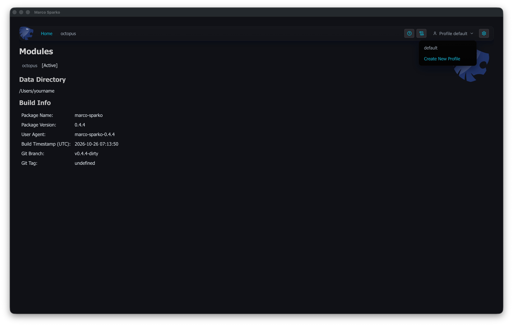
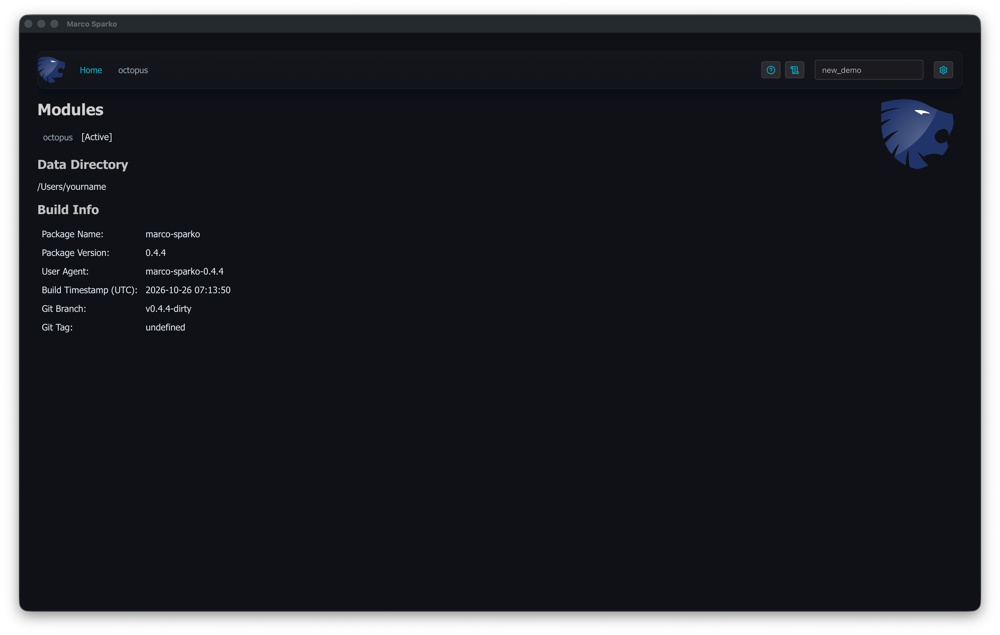
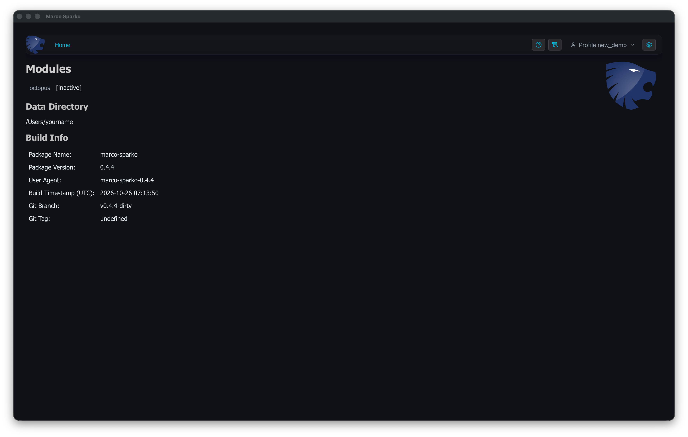

# Profiles

Marco Sparko will create a file in your home directory called ```.marco-sparko``` which contains the stored credentials it needs to access the various data providers. It is possible to have multiple profiles, each of which is entirely independent of the others, they have separate login credentials and data caches so if you manage multiple Octopus Energy accounts you can use profiles to easily switch between them.

In the application there is a profile selector at the top right of the screen which you can use to switch profiles, create new ones or delete them. They can also be selected by passing the command line parameter ```--profile=test_profile``` where test_profile is the name of the profile to be used.

## Creating a Profile

Click the profile menu at the top right, which shows the name of the active profile, to see all the profiles, change
to another one, or create a new one:



Click ```Create New Profile```, type a name for it, which may have letters, digits and underscores, and press
```Enter```:



The new profile becomes the active one. It has no logins yet, so its modules are ```[inactive]``` until you log in to
them, see [Logging in to Octopus](../octopus/initOctopus.md):



## Moving the Data Directory
The ```.marco-sparko``` file and the ```.marco-sparko-cache``` directory (see [Cached Data](cachedData.md)) are kept in your home directory unless you choose another data directory, for example on another drive to keep the credentials separate or to save space. The data directory is the first of these which is set:

1. The command line option ```--home=/path/to/directory```
2. The environment variable ```MARCO_SPARKO_HOME```
3. The path in a file in your home directory called ```.marco-sparko-home```, which contains just the full path of the directory, e.g. ```/Volumes/Secure/marco-sparko```. A path starting with ```~/``` is in your home directory.
4. Your home directory

On macOS, apps started from the Dock or Finder do not see environment variables set in your shell, so use the ```.marco-sparko-home``` file there.

To move existing data, quit Marco Sparko, move ```.marco-sparko``` and ```.marco-sparko-cache``` from your home directory into the new directory, and create the ```.marco-sparko-home``` file. The data directory in use is shown on the Home page.

The data directory is created if the directory containing it exists. If it does not, for example because it is on a drive which is not connected, Marco Sparko shows an error rather than using your home directory, so that credentials are never stored somewhere you did not choose. The data directory should only be accessible by you, on macOS and Linux a warning is printed if it is not (```chmod 700``` fixes this).

When any module is initialised, if there is a current profile then the configuration will be added to that profile, otherwise a new profile called ```default``` will be created. The ```.marco-sparko``` file is a JSON document containing an array of profiles similar to this:

```
[
  {
    "name": "default",
    "modules": {
      "octopus": {
        "apiKey": "sk_live_XXXXXXXXXXXXXXXXXXXXXX",
        "billingTimezone": "Europe/London"
      }
    }
  },
  {
    "name": "test_profile",
    "modules": {
      "octopus": {
        "apiKey": "sk_live_XXXXXXXXXXXXXXXXXXXXXX",
        "billingTimezone": "Europe/London"
      }
    }
  }
]
```

The first profile listed will be used unless another is specified by passing the command line parameter ```--profile=test_profile``` where test_profile is the name of the profile to be used. Profiles are entirely independent of each other, they have separate credentials, may have different combinations of modules enabled, and have separate data caches.
