# Installing on Windows

How to download Marco Sparko for your PC and install it. The app is not signed, so Windows warns about the download
and the installer, and this shows how to keep and run them.

## Download the Release Binary

Navigate to [https://github.com/bruceskingle/marco-sparko/releases/](https://github.com/bruceskingle/marco-sparko/releases/) to find the
latest release: 

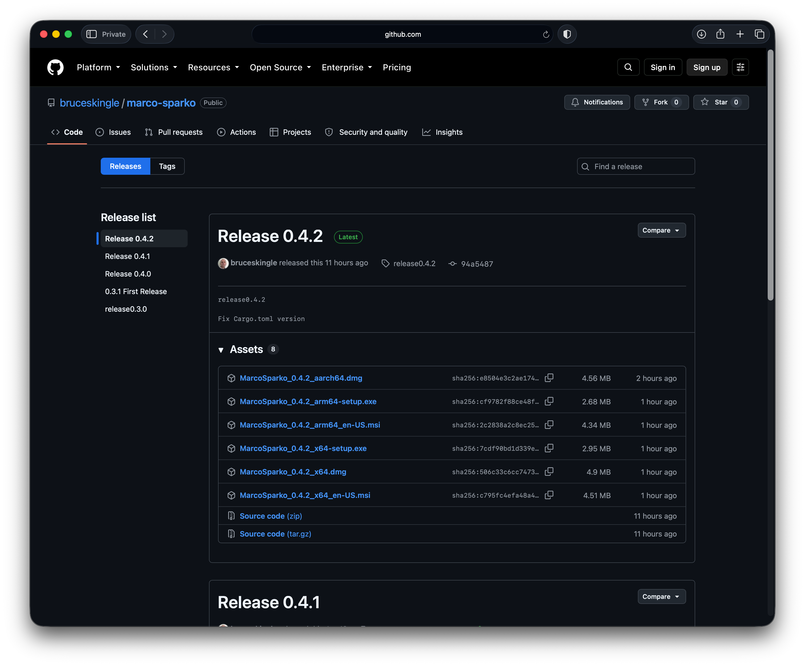

Look for the one with the  label, and then select the correct version for your computer, either
```MarcoSparko_0.4.2_x64-setup.exe``` for Intel based computers or ```MarcoSparko_0.4.2_arm64-setup.exe``` for ARM64 based computers (the version number ```0.4.2``` may be different of course).

Releases up to 0.4.3 also had ```.msi``` files, which were just a different way of installing. From 0.4.4 there is only the ```setup.exe```.

When you download the file you will see this warning like this:

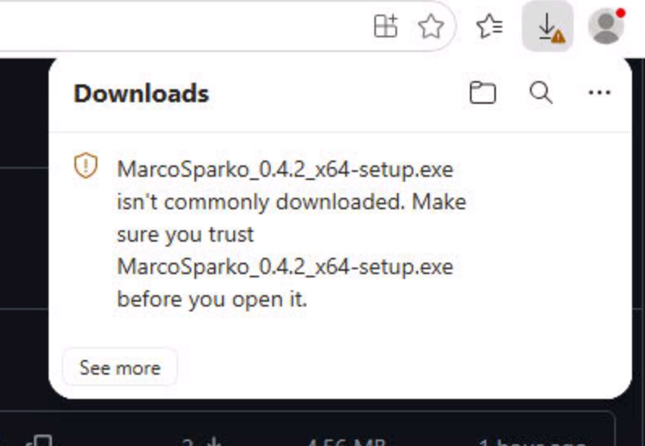

Hover over the download item and an ellipsis menu (```...```) will appear, click that and then select ```Keep``` from the pop up menu.

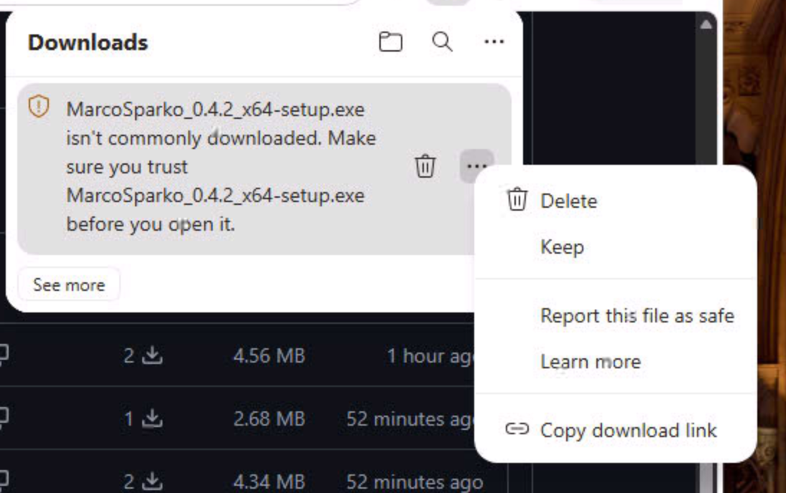

You will then see another warning like this, click on the down arrow (not the word ```Delete```) and select ```Keep Anyway```

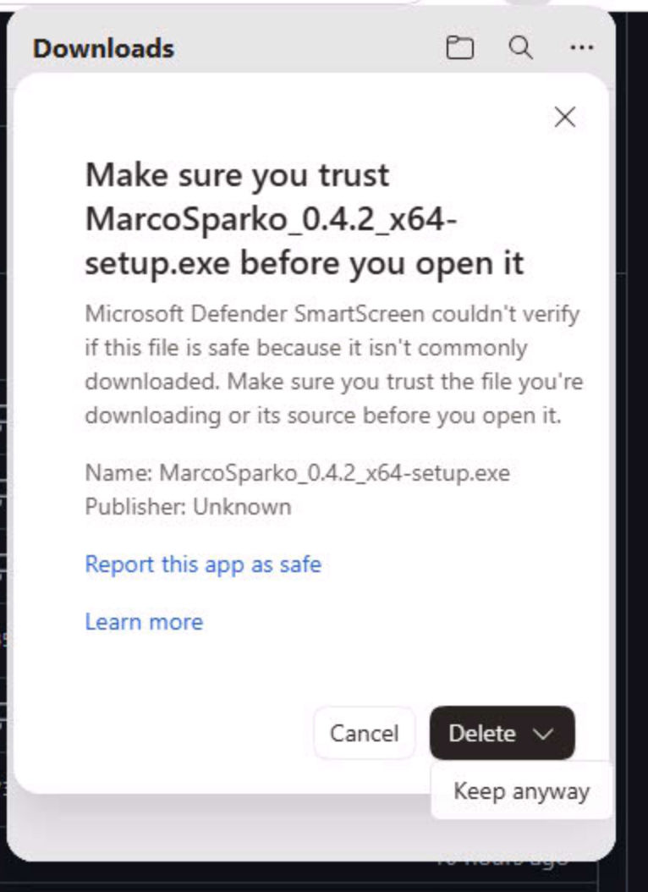

The download should then appear as normal and you should be able to click on ```Open file```

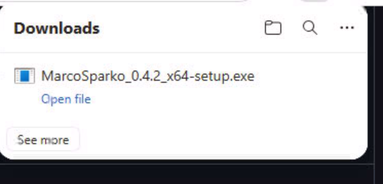

The installer will then start, click ```Next >```

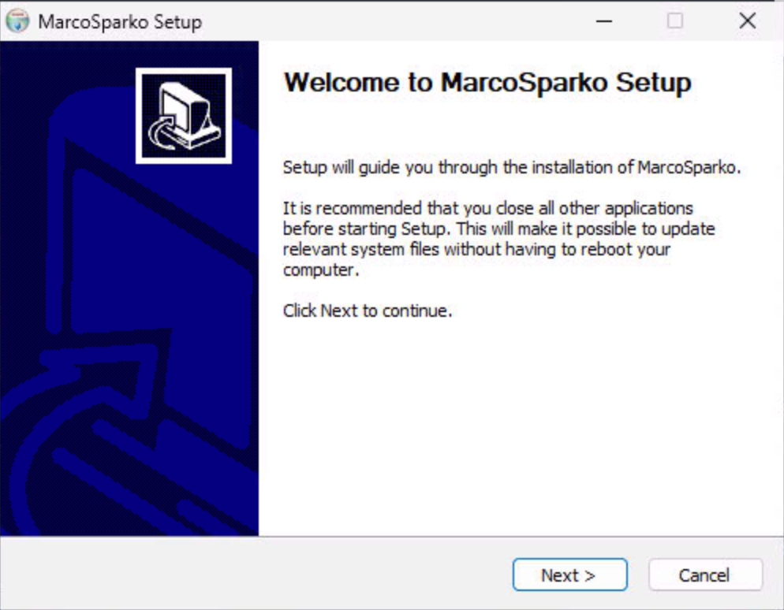

If you have already installed the application you will see this dialog, select ```Uninstall before installing``` and click ```Next>```

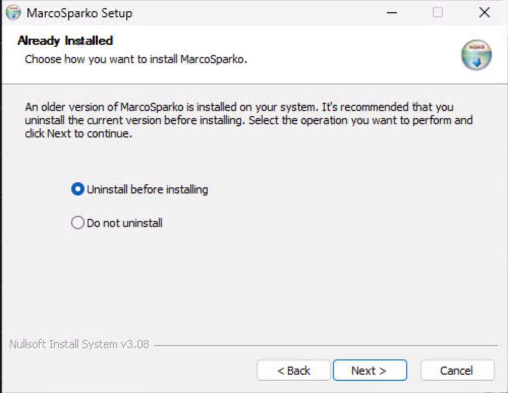

Leave ```Delete the application data``` unchecked and click ```Uninstall```.

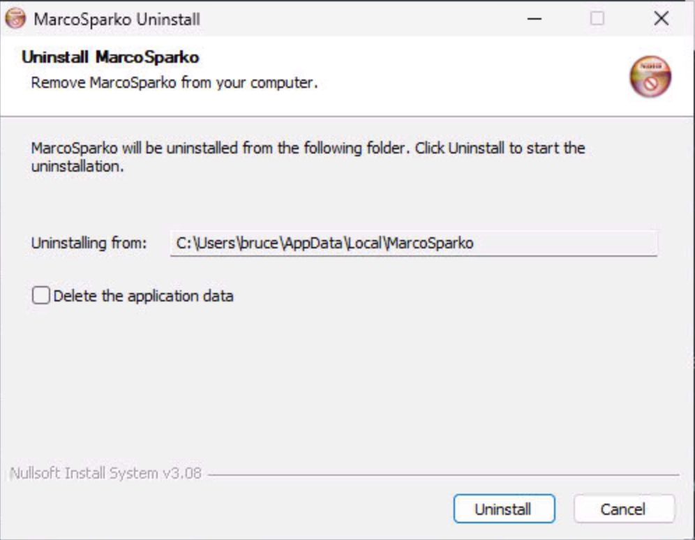

When the uninstall completes click ```Close```

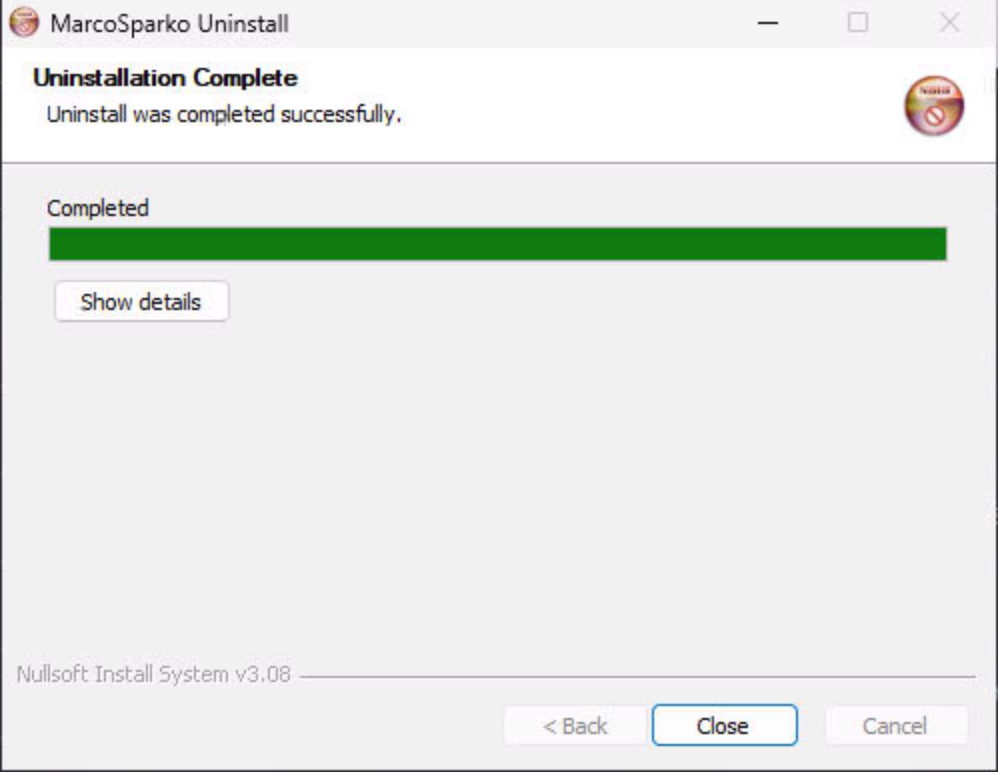

Then the installer will start, leave the ```Destination Folder``` as is and click ```Next>```

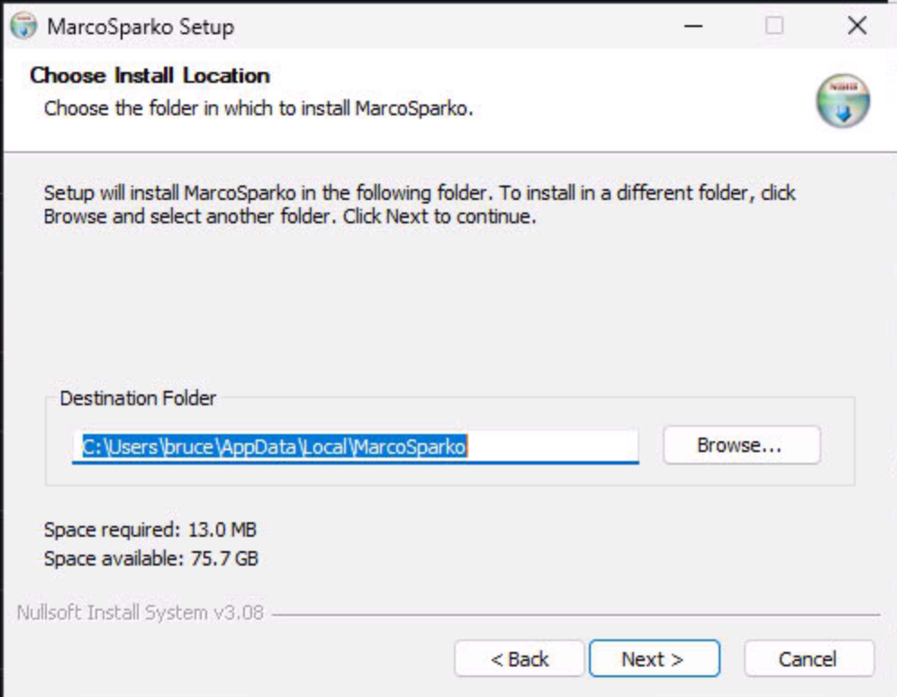

When the uninstall completes click ```Next```

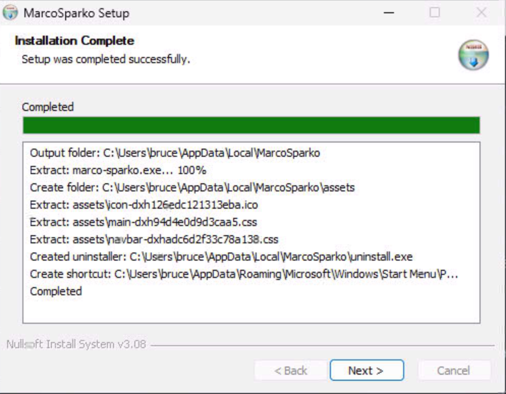

Finally click ```Finish```, the setup wizard will close and the application should start.

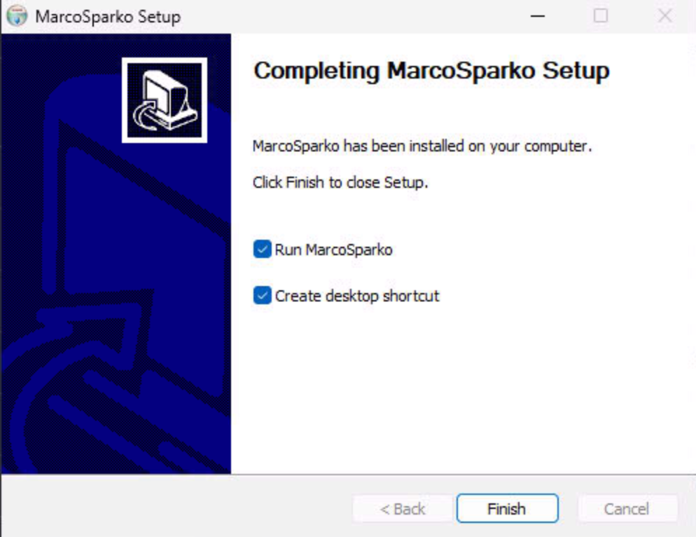
