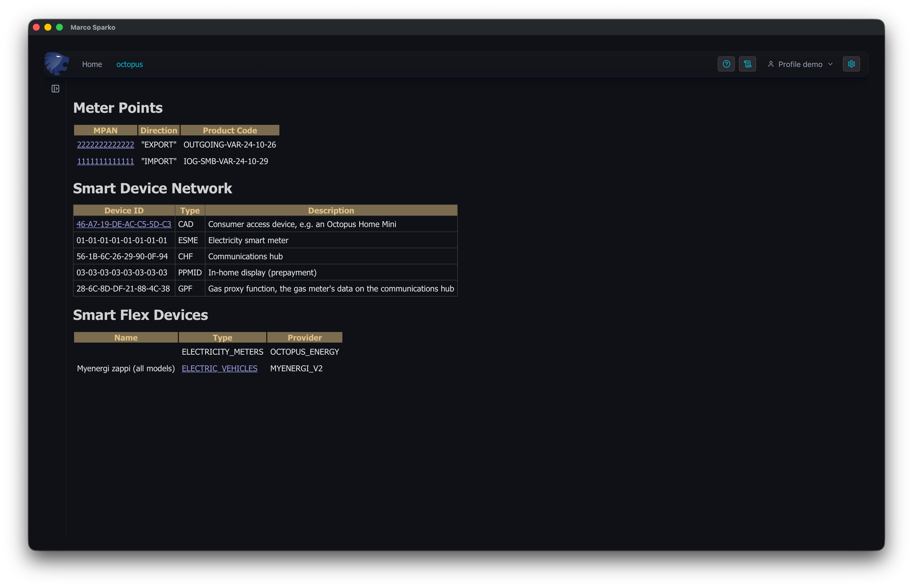
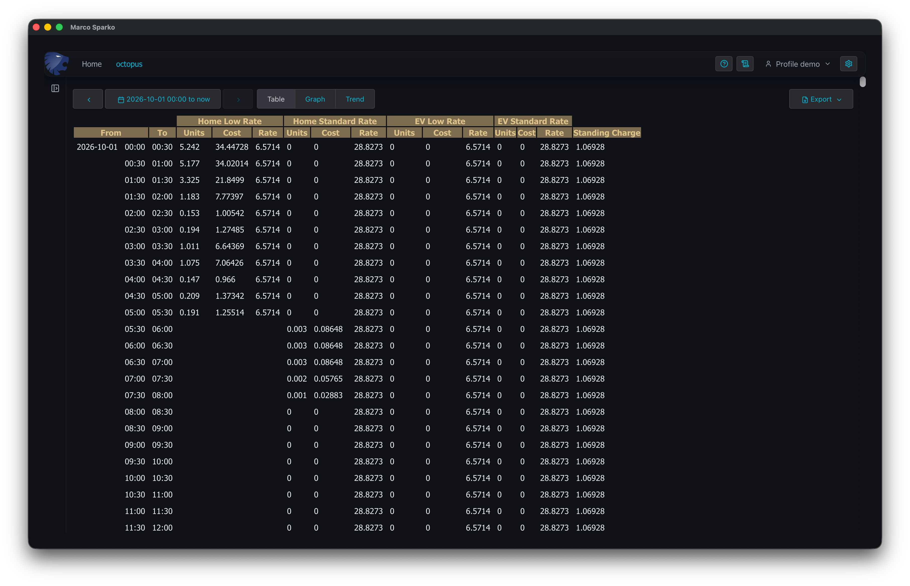
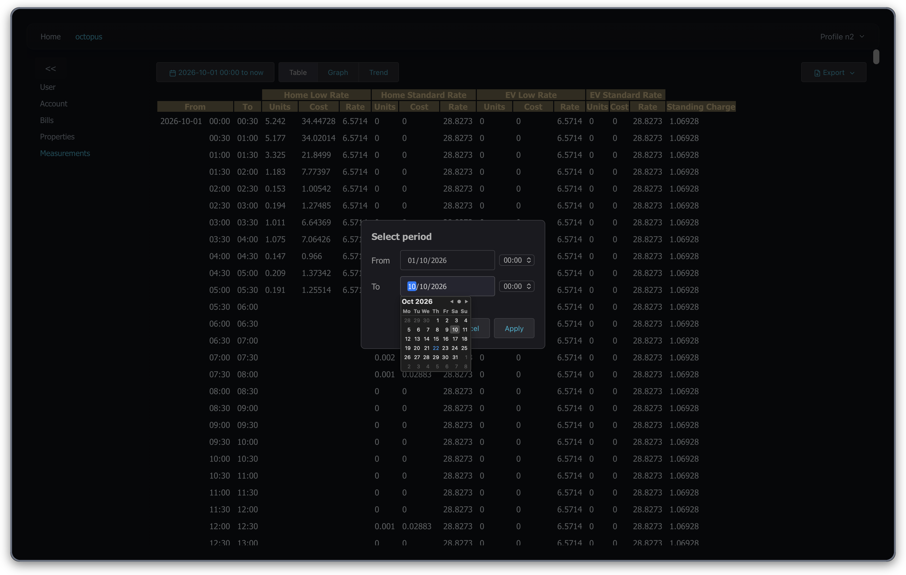
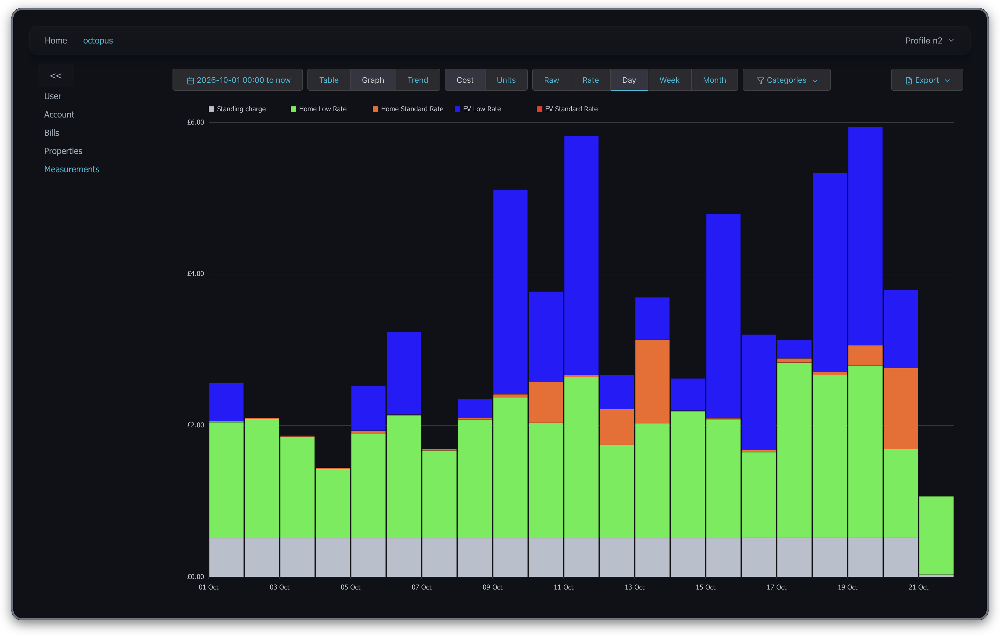
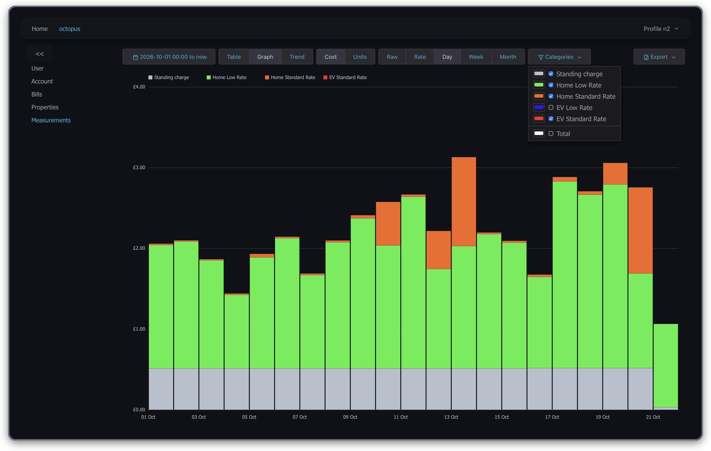
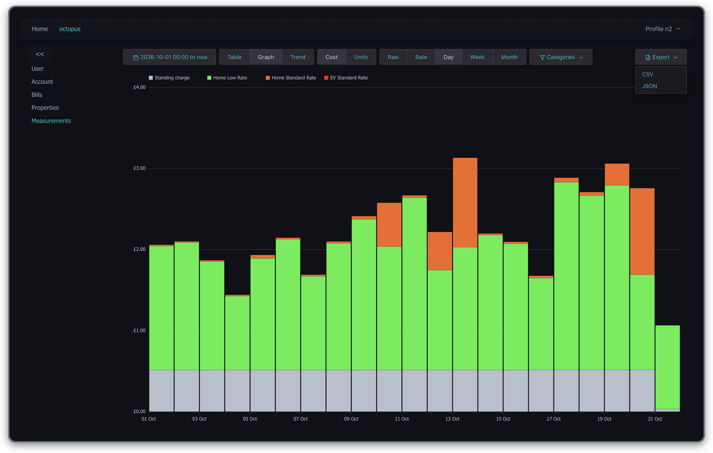
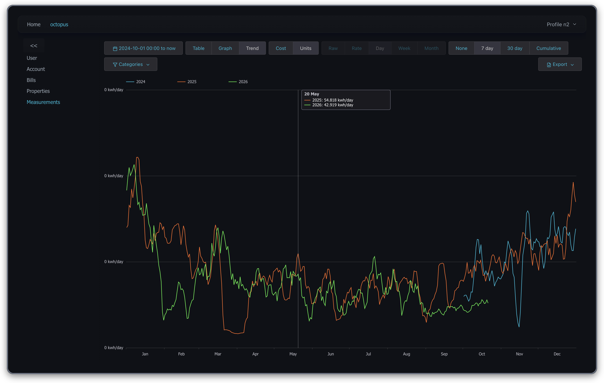
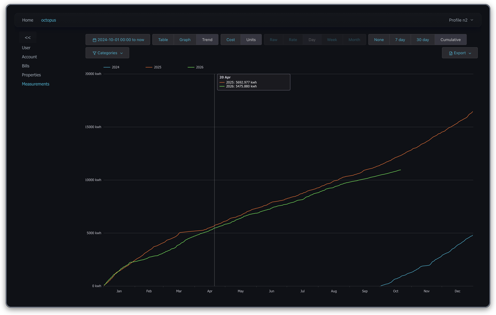

[< Bills](../bills.md)
# Measurements
The measurements page shows the half hourly readings from your smart meters, broken down by the rate you were charged at, together with what each half hour cost. You can view the readings as a table, as a stacked bar graph, or as a trend graph which compares one year with another.

## Choosing a Meter Point
Open the Octopus module page by clicking on ```octopus``` in the top menu bar if necessary, and then click on ```Measurements``` on the left menu. You will see a list of your electricity meter points:



Each line shows the MPAN (the meter point's ID, as shown on your bill), whether the meter point is for import (electricity you use) or export (electricity you generate and sell back), and the product code of the tariff it is currently on. Click on an MPAN to see the measurements for that meter point.

The readings are downloaded from Octopus the first time you look at a period and are then kept in a local cache, so the first time you look at a long period there may be a delay while the data is downloaded. After that only new readings need to be fetched.

## The Table View
The measurements page opens in the table view, showing the readings from the start of the current month until now:



Each line is one 30 minute reading. For each rate on your tariff (in this example ```Home Low Rate```, ```Home Standard Rate```, ```EV Low Rate``` and ```EV Standard Rate``` from Intelligent Octopus Go) there are three columns:

- **Units** the number of units (kWh) used in that half hour at that rate
- **Cost** what those units cost, in pence including VAT
- **Rate** the unit rate in pence per kWh, including VAT

The final column is the standing charge for that half hour, in pence.

A rate which did not apply to a half hour is left blank. In this example you can see that the ```Home Low Rate``` columns are blank from 05:30, when the cheap overnight period ended and consumption was charged at the ```Home Standard Rate```.

For an export meter point the table shows the units exported and what you were paid for them.

## Choosing the Period
The button at the top left shows the period being displayed. Click it to choose a different period:



Enter the date and time to start from and to finish at, then click ```Apply```. Alternatively tick the ```Up to now``` check box below the ```To``` date (it is hidden behind the calendar in the screenshot above) to have the period run until now. The ```To``` date and time are greyed out while ```Up to now``` is ticked.

The same period is used by the table and both graphs, so you can switch between the views without choosing it again.

## The Graph View
Click ```Graph``` to see the readings as a stacked bar graph:



Each bar is split into a coloured section for each rate, with the standing charge at the bottom. Hover the mouse over a bar to see the values that make it up.

The buttons along the top control what the graph shows:

- **Cost / Units** show what the consumption cost, or how many units were used. The standing charge is only shown in ```Cost``` mode.
- **Raw** shows a bar for each 30 minute reading.
- **Rate** joins together consecutive readings with the same unit rates, so you get one bar for each run of time charged at the same rates, e.g. one for the cheap overnight period and one for the rest of the day. Because these bars cover different lengths of time their heights are per hour, so the area of each bar is its total.
- **Day / Week / Month** add the readings up into a bar for each day, week or month.

```Raw``` and ```Rate``` are most useful for looking at a single day, while ```Day```, ```Week``` and ```Month``` are better for longer periods.

### Choosing Categories
Click ```Categories``` to choose which categories are shown:



Untick a category to hide it, here the ```EV Low Rate``` has been hidden so that we can see the cost of the electricity used by the house alone. Click the coloured box next to a category to change its colour.

Tick ```Total``` to replace the visible categories with a single bar showing their total.

## Exporting the Data
Click ```Export``` to save the data being shown to a file, as either CSV (which can be opened in a spreadsheet) or JSON:



In the table view this saves each reading, as shown in the table. In the graph and trend views it saves the values of each bar, added up by the period selected with the ```Raw```, ```Rate```, ```Day```, ```Week``` or ```Month``` buttons.
In the JSON export the date/times are output in ISO format with timezone offsets, in the csv export the dates are exported in a format most spreadsheets can recognize, note that on the day where daylight savings time ends this means there are two rows with
the same date/time.

## The Trend View
Click ```Trend``` to compare your consumption in different years. For this to be useful choose a period covering more than one year, here it is from October 2024 until now:



The horizontal axis runs from January to December and there is a line for each year, each in its own colour, so you can see how this year compares with the same time last year. If more than one category is selected each category has its own line style (solid, dashed, dotted and so on), which is shown in the legend. Tick ```Total``` in the ```Categories``` menu to show a single line for each year with the total of all the categories.

Hover the mouse over the graph to see the values for each year on that day.

Day to day consumption varies a lot, which makes a graph of the daily values very spiky and hard to compare. The buttons on the right of the top row smooth the lines:

- **None** shows the values without smoothing, added up by the ```Raw```, ```Rate```, ```Day```, ```Week``` or ```Month``` buttons as in the graph view.
- **7 day** shows the average daily value over the week centred on each day. This smooths out differences between weekdays and weekends while still showing short term changes, such as a cold spell.
- **30 day** shows the average daily value over the 30 days centred on each day, which shows the seasonal pattern more clearly.
- **Cumulative** shows the running total since 1 January of each year.

The smoothing options all work from the daily totals, so the ```Raw```, ```Rate```, ```Day```, ```Week``` and ```Month``` buttons are greyed out while one of them is selected.

The example above uses the 7 day average. The cumulative graph below shows that by 20 April 2026 slightly less electricity had been used than by the same date in 2025, and the gap has widened over the summer:



[Profiles>](profiles.md)
